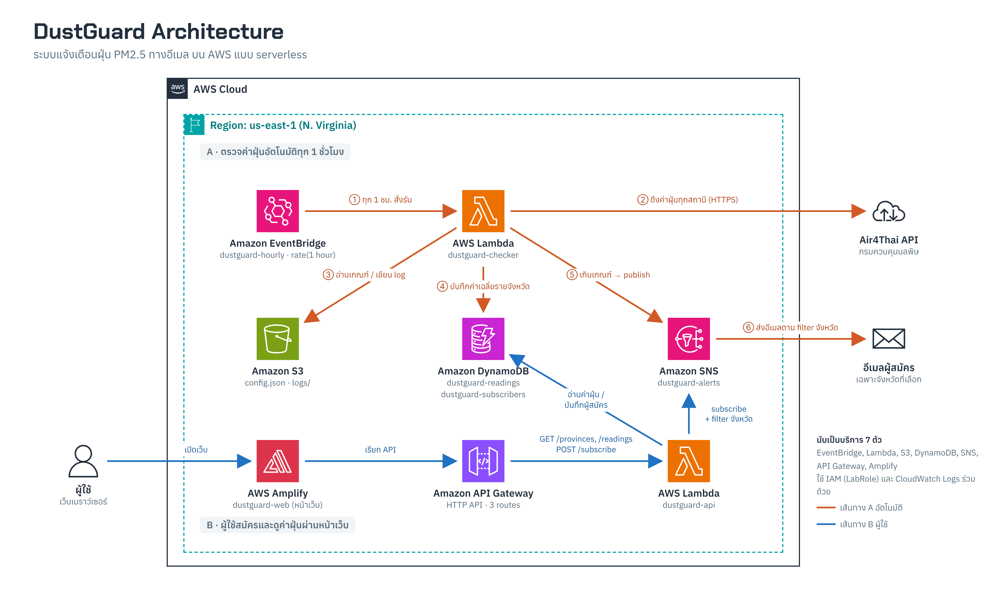

# DustGuard ระบบแจ้งเตือนฝุ่น PM2.5 ทางอีเมล

DustGuard เช็กค่าฝุ่น PM2.5 จาก Air4Thai ของกรมควบคุมมลพิษให้อัตโนมัติทุก 1 ชั่วโมง ถ้าค่าเฉลี่ยของจังหวัดที่ผู้ใช้เลือกเกิน **37.5 µg/m³** (ค่ามาตรฐานเฉลี่ย 24 ชม. ของไทย) ระบบจะส่งอีเมลเตือนพร้อมคำแนะนำการดูแลสุขภาพไปให้ทันที ผู้ใช้สมัครผ่านหน้าเว็บ ใส่อีเมล เลือกจังหวัด แล้วกดยืนยันในอีเมลครั้งเดียว

ทั้งระบบเป็น serverless บน AWS ใช้ **7 บริการ** ทำงานเองอัตโนมัติ และดึงข้อมูลจริงจาก API ภายนอก ตามเกณฑ์ Level 4

- วิชา CS446 Cloud Computing มหาวิทยาลัยกรุงเทพ
- เว็บที่ใช้งานอยู่: https://staging.d3dih4rbpnpxgo.amplifyapp.com

| สมาชิก | รหัสนักศึกษา |
|---|---|
| ชิษณุพงศ์ มัดจุปะ (หัวหน้ากลุ่ม) | 1660707306 |
| ดำรงค์ สว่างวงศ์ | 1660707173 |
| พงศภัค สงวนสุทธิ์ | 1660707884 |

## สารบัญ

1. [สถาปัตยกรรม](#1-สถาปัตยกรรม)
2. [สิ่งที่ต้องมีก่อนเริ่ม](#2-สิ่งที่ต้องมีก่อนเริ่ม)
3. [สร้างทีละบริการผ่าน AWS Console (~45 นาที)](#3-สร้างทีละบริการผ่าน-aws-console-45-นาที)
4. [ทดสอบระบบ](#4-ทดสอบระบบ)
5. [แก้ปัญหาที่เจอบ่อย](#5-แก้ปัญหาที่เจอบ่อย)
6. [ลบทรัพยากรหลังใช้งาน](#6-ลบทรัพยากรหลังใช้งาน)
7. [ความปลอดภัยและการออกแบบ](#7-ความปลอดภัยและการออกแบบ)
8. [โครงสร้างไฟล์ใน repo](#8-โครงสร้างไฟล์ใน-repo)

---

## 1. สถาปัตยกรรม



ระบบทำงาน 2 เส้นทาง

**เส้นทาง A: ตรวจค่าฝุ่นอัตโนมัติทุก 1 ชั่วโมง**

1. **EventBridge** (rule `dustguard-hourly`, `rate(1 hour)`) สั่งรัน Lambda `dustguard-checker`
2. Lambda ดึงค่าฝุ่นของทุกสถานีจาก Air4Thai แล้วหาค่าเฉลี่ยรายจังหวัด (ข้ามสถานีที่ไม่มีค่า หรือข้อมูลเก่ากว่า 6 ชม.)
3. อ่านเกณฑ์และรายชื่อจังหวัดจาก `config.json` ใน **S3** และเขียน log รายวันลง `logs/` ใน bucket เดียวกัน
4. บันทึกค่าเฉลี่ยของแต่ละจังหวัดลง **DynamoDB** ตาราง `dustguard-readings`
5. จังหวัดที่เกินเกณฑ์ (และพ้น cooldown 6 ชม.) จะ publish ข้อความเข้า **SNS** topic `dustguard-alerts` พร้อม attribute `province`
6. SNS ใช้ **filter policy** ส่งอีเมลเฉพาะผู้สมัครของจังหวัดนั้น

**เส้นทาง B: ผู้ใช้สมัครและดูค่าฝุ่นผ่านหน้าเว็บ**

1. ผู้ใช้เปิดหน้าเว็บที่โฮสต์บน **Amplify**
2. หน้าเว็บเรียก **API Gateway** (HTTP API) ซึ่งส่งต่อไปที่ Lambda `dustguard-api`
3. `GET /provinces` ได้รายชื่อจังหวัด, `GET /readings` ได้ค่าฝุ่นล่าสุดจาก DynamoDB, `POST /subscribe` สมัคร SNS แบบมี filter จังหวัด และบันทึกผู้สมัครลงตาราง `dustguard-subscribers`

| บริการ | ใช้ทำอะไร | ชื่อทรัพยากร |
|---|---|---|
| Amazon EventBridge | สั่งรัน checker ทุกชั่วโมง | `dustguard-hourly` |
| AWS Lambda | ตรวจค่าฝุ่น / รับคำขอจากหน้าเว็บ | `dustguard-checker`, `dustguard-api` |
| Amazon S3 | เก็บ config และ log รายวัน | `dustguard-data-...` |
| Amazon DynamoDB | ค่าฝุ่นรายชั่วโมง / รายชื่อผู้สมัคร | `dustguard-readings`, `dustguard-subscribers` |
| Amazon SNS | ส่งอีเมลเตือนตามจังหวัด | `dustguard-alerts` |
| Amazon API Gateway | ทางเข้า API ของหน้าเว็บ | `dustguard-http-api` |
| AWS Amplify | โฮสต์หน้าเว็บ | `dustguard-web` |

ใช้ IAM (`LabRole`) และ CloudWatch Logs ร่วมด้วย แต่ 2 ตัวนี้ไม่นับเป็นบริการตามเกณฑ์วิชา

---

## 2. สิ่งที่ต้องมีก่อนเริ่ม

- บัญชี **AWS Academy Learner Lab** กด **Start Lab** แล้วรอจนจุดเป็นสีเขียว จากนั้นกด **AWS**
- ทุกขั้นทำใน region **us-east-1 (N. Virginia)** ดูได้ที่มุมขวาบนของ Console
- Lambda ทุกตัวใช้ role **`LabRole`** ที่ Learner Lab มีให้ (Learner Lab สร้าง IAM role เองไม่ได้)
- อีเมลสำหรับทดสอบรับแจ้งเตือน 1 อัน

---

## 3. สร้างทีละบริการผ่าน AWS Console (~45 นาที)

สร้างตามลำดับขั้น 1–8 นี้ เพราะขั้นหลังต้องใช้ค่าจากขั้นก่อน เปิด Notepad ไว้จด 4 ค่า: **ชื่อ bucket**, **SNS Topic ARN**, **API Invoke URL** และ **URL เว็บ**

ดาวน์โหลด repo นี้ลงเครื่องก่อน (ปุ่ม **Code → Download ZIP** แล้วแตกไฟล์)

> คัดลอกชื่อทรัพยากรจากคู่มือนี้ไปวาง อย่าพิมพ์เอง ถ้าตั้งชื่อ Lambda ผิด จะเปลี่ยนชื่อทีหลังไม่ได้ ต้องลบแล้วสร้างใหม่

### ขั้น 1: DynamoDB (2 ตาราง)

1. ค้นหา **DynamoDB** → **Tables** → **Create table**
2. กรอกตามตาราง แล้วกด **Create table** ทำซ้ำสำหรับตารางที่สอง
3. รอจน Status ของทั้ง 2 ตารางเป็น **Active**

| ช่อง | ตารางแรก | ตารางที่สอง |
|---|---|---|
| Table name | `dustguard-readings` | `dustguard-subscribers` |
| Partition key | `province` (String) | `email` (String) |
| Sort key | `ts` (String) | เว้นว่าง |
| Table settings | Customize settings | Customize settings |
| Capacity mode | On-demand | On-demand |

### ขั้น 2: S3 bucket + config.json

1. ค้นหา **S3** → **Create bucket**
2. Bucket type: **General purpose** · Bucket namespace: **Account Regional** · Bucket name prefix: `dustguard-data` (ถ้าไม่มีช่อง namespace ให้ตั้งชื่อ `dustguard-data-<รหัสนักศึกษา>`)
3. **Block all public access** ติ๊กไว้ตามเดิม bucket นี้เป็น private
4. กด **Create bucket** แล้วจด**ชื่อ bucket เต็ม** (เช่น `dustguard-data-123456789012-us-east-1-an`)
5. เข้า bucket → **Upload** → เลือกไฟล์ `config/config.json` → **Upload**

### ขั้น 3: SNS topic

1. ค้นหา **SNS** → **Topics** → **Create topic**
2. Type: **Standard** (ห้ามเลือก FIFO เพราะ FIFO ส่งอีเมลไม่ได้) · Name: `dustguard-alerts`
3. กด **Create topic** แล้วจด **ARN** (`arn:aws:sns:us-east-1:...:dustguard-alerts`)
4. ไม่ต้องสร้าง subscription เอง หน้าเว็บจะสร้างให้ตอนผู้ใช้สมัคร

### ขั้น 4: Lambda `dustguard-checker`

1. ค้นหา **Lambda** → **Create function** (บางหน้าจอชื่อ Create Event Function) → **Author from scratch**
   - Function name: `dustguard-checker`
   - Runtime: **Python 3.12**
   - **Additional settings** → เปิด **Custom execution role** → เลือก **LabRole**
2. แท็บ **Code**: เปิดไฟล์ `lambdas/checker/lambda_function.py` ในเครื่อง คัดลอกทั้งหมด วางทับในไฟล์ `lambda_function.py` บน Console แล้วกด **Deploy**
   - เช็กว่าบรรทัดบน ๆ มี `import ssl` ถ้าไม่มีแปลว่าคัดลอกผิดไฟล์
3. **Configuration → General configuration → Edit**: Memory `256` MB, Timeout `1 min 0 sec` → **Save** (ค่าเริ่มต้น 3 วินาทีไม่พอ)
4. **Configuration → Environment variables → Edit** ใส่ 3 ตัว → **Save**

| Key | Value |
|---|---|
| `TABLE_READINGS` | `dustguard-readings` |
| `BUCKET` | ชื่อ bucket เต็มจากขั้น 2 |
| `TOPIC_ARN` | ARN จากขั้น 3 |

5. แท็บ **Test** → **Create new event** → Event name `FetchOnly` → JSON ด้านล่าง → **Save** → **Test**

```json
{"test_threshold": 999}
```

ต้องขึ้น **Succeeded** และผลลัพธ์มี `"provinces_checked"` 6–7 จังหวัด ใน log จะมีบรรทัด `[WARN] ตรวจใบรับรอง SSL ของ Air4Thai ไม่ผ่าน...` ซึ่งเป็นเรื่องปกติ (ดูหัวข้อ 7)

### ขั้น 5: EventBridge ทุก 1 ชั่วโมง

1. ในหน้า `dustguard-checker` กด **Add trigger**
2. Source: **EventBridge (CloudWatch Events)** → **Create a new rule**
   - Rule name: `dustguard-hourly`
   - Rule type: **Schedule expression (Legacy)** (ไม่ต้องกด Continue in EventBridge Scheduler)
   - Schedule expression: `rate(1 hour)`
3. กด **Add** ใน Configuration → Triggers ต้องเห็น `dustguard-hourly` สถานะ **ENABLED**

### ขั้น 6: Lambda `dustguard-api`

1. **Create function** → Author from scratch → Function name `dustguard-api` → **Python 3.12** → Custom execution role **LabRole**
2. วางโค้ดจาก `lambdas/api/lambda_function.py` (บรรทัดที่ 2 ต้องเขียนว่า `dustguard-api`) → **Deploy**
3. General configuration: Memory `256` MB, Timeout `1 min`
4. Environment variables ใส่ 4 ตัว

| Key | Value |
|---|---|
| `TABLE_SUBSCRIBERS` | `dustguard-subscribers` |
| `TABLE_READINGS` | `dustguard-readings` |
| `BUCKET` | ชื่อ bucket เต็มจากขั้น 2 |
| `TOPIC_ARN` | ARN จากขั้น 3 |

### ขั้น 7: API Gateway (HTTP API) + CORS

1. ค้นหา **API Gateway** → **Create API** → กล่อง **HTTP API** → **Build**
2. **Add integration** → **Lambda** → region `us-east-1` → `dustguard-api` · API name: `dustguard-http-api` → **Next**
3. Configure routes: แก้แถวที่ระบบใส่มาให้ แล้วกด **Add route** จนครบ 3 แถว → **Next**

| Method | Resource path | Integration target |
|---|---|---|
| GET | `/provinces` | dustguard-api |
| GET | `/readings` | dustguard-api |
| POST | `/subscribe` | dustguard-api |

4. Stage `$default`, Auto-deploy เปิดไว้ → **Next** → **Create**
5. เมนูซ้าย **CORS** → **Configure**
   - Access-Control-Allow-Origin: `*`
   - Access-Control-Allow-Headers: `content-type`
   - Access-Control-Allow-Methods: `GET`, `POST`, `OPTIONS`
   - กด **Save**
6. จด **Invoke URL** (เช่น `https://abc123.execute-api.us-east-1.amazonaws.com`) **ไม่ต้องมี `/` ปิดท้าย**
7. ทดสอบ: เปิด `<Invoke URL>/provinces` ในเบราว์เซอร์ ต้องเห็น `{"provinces": [...], "threshold": 37.5}`

### ขั้น 8: หน้าเว็บ + Amplify

1. เปิด `web/config.js` ในเครื่อง แก้ให้เหลือบรรทัดเดียวแบบนี้ (ใส่ Invoke URL ของตัวเอง) แล้วบันทึก

```javascript
const API_URL = 'https://abc123.execute-api.us-east-1.amazonaws.com';
```

2. เข้าไป**ในโฟลเดอร์** `web` เลือก 4 ไฟล์ (`index.html`, `style.css`, `app.js`, `config.js`) → คลิกขวา → **Compress to ZIP file** → ตั้งชื่อ `web.zip`
   - ต้อง zip ไฟล์ข้างใน ห้าม zip ตัวโฟลเดอร์ `web` ไม่งั้นเว็บจะขึ้น 404
3. ค้นหา **Amplify** → **Deploy an app** → **Deploy without Git** → **Next**
4. App name: `dustguard-web` · Method: **Drag and drop** → ลาก `web.zip` ใส่ → **Save and deploy**
5. รอจนขึ้น **Deployed** → **Visit deployed URL**

ต้องเห็น dropdown มีจังหวัดครบ และตารางค่าฝุ่นมีตัวเลขพร้อมป้ายสี จากนั้นไปทดสอบต่อที่[หัวข้อ 4](#4-ทดสอบระบบ)

---

## 4. ทดสอบระบบ

| ขั้น | ทำอะไร | ผลที่ต้องได้ |
|---|---|---|
| 1 | หน้าเว็บ: กรอกอีเมล เลือกจังหวัด กด **สมัคร** | ขึ้น "เช็กอีเมลแล้วกด Confirm subscription" |
| 2 | เปิดอีเมล **AWS Notification - Subscription Confirmation** (ดู spam ด้วย) กด **Confirm subscription** | ขึ้นหน้า "Subscription confirmed!" |
| 3 | SNS → `dustguard-alerts` → Subscriptions | สถานะ **Confirmed** และ filter policy เป็น `{"province":["<จังหวัดที่เลือก>"]}` |
| 4 | บังคับส่งเตือน: Lambda `dustguard-checker` → แท็บ **Test** → Create new event ชื่อ `TestAlert` ใส่ `{"test_threshold": 5}` → **Test** | ขึ้น Succeeded และผลลัพธ์มี `"alerts_sent"` มากกว่า 0 |
| 5 | เปิดอีเมล | ได้อีเมล "⚠️ DustGuard: PM2.5 <จังหวัด> ..." **เฉพาะจังหวัดที่สมัคร** แม้ระบบจะส่งเตือนหลายจังหวัด |

ถ้าอีเมลเดิมเคยสมัครและยืนยันแล้ว การสมัครซ้ำจะแค่เปลี่ยนจังหวัดให้ ("เปลี่ยนจังหวัดเป็น ... เรียบร้อยแล้ว") โดยไม่ส่งอีเมลยืนยันใหม่ ถ้าอยากทดสอบขั้นยืนยันอีกรอบ ให้ใช้อีเมลอื่น หรือกดลิงก์ unsubscribe ท้ายอีเมลเตือนก่อน

ตอนใช้งานจริง ระบบส่งเตือนเฉพาะจังหวัดที่ค่าเฉลี่ยเกิน 37.5 µg/m³ และส่งซ้ำไม่เกินทุก 6 ชม. ต่อจังหวัด

---

## 5. แก้ปัญหาที่เจอบ่อย

| อาการ | สาเหตุ / วิธีแก้ |
|---|---|
| Lambda: `Task timed out after 3.00 seconds` | ยังไม่ได้ตั้ง Timeout เป็น 1 นาที |
| Lambda: `CERTIFICATE_VERIFY_FAILED` ที่บรรทัด `urlopen` | วางโค้ดเวอร์ชันเก่า ให้วางโค้ดจาก repo นี้ใหม่ (ต้องมี `import ssl`) แล้วกด **Deploy** |
| Lambda: `NoSuchBucket` / `AccessDenied` หรือ log ขึ้น `อ่าน config.json ไม่ได้` | ค่า `BUCKET` ใน Environment variables ไม่ตรงกับชื่อ bucket เต็ม |
| Lambda: `ResourceNotFoundException` | ชื่อตารางสะกดผิด หรือตารางยังไม่ Active |
| Lambda ตอบแค่ `Hello from Lambda!` | วางโค้ดแล้วยังไม่ได้กด **Deploy** |
| `/provinces` ขึ้น `Not Found` | route ยังเป็น `ANY /dustguard-api` หรือสะกด path ผิด |
| `/provinces` ขึ้น `Internal Server Error` | ดู CloudWatch log ของ `dustguard-api` ส่วนใหญ่เป็น Environment variables ผิด |
| หน้าเว็บขึ้น "โหลดรายชื่อจังหวัดไม่ได้" | เปิด `<URL เว็บ>/config.js` ดู ถ้ายังเป็น `xxxx` ให้แก้ `config.js` แล้ว zip ใหม่ → Amplify **Deploy updates** ถ้า URL ถูกแล้ว ให้ตั้ง CORS ตามขั้น 7 |
| กดสมัครแล้วขึ้น `Failed to fetch` | ยังไม่ได้ตั้ง CORS (คำขอ POST ต้องผ่าน CORS) |
| Amplify ขึ้น 404 | zip ตัวโฟลเดอร์แทนไฟล์ข้างใน |
| ขึ้น "อีเมลนี้สมัครไว้แล้วแต่ยังไม่ได้กด Confirm" | หาอีเมลยืนยันฉบับเก่าแล้วกด Confirm ก่อน |
| บางจังหวัดขึ้น "ไม่มีข้อมูล" | สถานีของจังหวัดนั้นไม่ได้ส่งค่าใหม่เกิน 6 ชม. ระบบจึงไม่ใช้ค่าเก่า เมื่อสถานีกลับมาส่งค่าจะขึ้นเอง |
| ไม่ได้อีเมลเตือน | ยังไม่กด Confirm, อีเมลอยู่ใน spam หรือเลือกจังหวัดที่ไม่มีข้อมูล |

---

## 6. ลบทรัพยากรหลังใช้งาน

ลบหลัง demo เสร็จเท่านั้น ลบแล้วกู้คืนไม่ได้ การกด End Lab **ไม่ได้**ลบอะไร ลบตามลำดับนี้ แต่ละหน้าจะให้พิมพ์คำยืนยันก่อนลบ

1. **Amplify** → `dustguard-web` → App settings → General settings → **Delete app**
2. **API Gateway** → `dustguard-http-api` → **Delete**
3. **EventBridge** → Rules → `dustguard-hourly` → **Delete**
4. **Lambda** → ติ๊ก `dustguard-checker` และ `dustguard-api` → Actions → **Delete**
5. **SNS** → Topics → `dustguard-alerts` → **Delete** (subscription ทั้งหมดหายตาม)
6. **DynamoDB** → Tables → ติ๊ก `dustguard-readings` และ `dustguard-subscribers` → **Delete**
7. **S3** → เลือก bucket → **Empty** ก่อน แล้วค่อย **Delete** (bucket ที่ยังมีไฟล์อยู่จะลบไม่ได้)
8. (ถ้าต้องการ) **CloudWatch** → Log groups → ลบ `/aws/lambda/dustguard-checker` และ `/aws/lambda/dustguard-api`

---

## 7. ความปลอดภัยและการออกแบบ

**ความปลอดภัย**

- **S3 เป็น private:** เปิด Block all public access ไว้ มีแค่ Lambda ที่อ่านเขียน bucket ได้
- **ยืนยันอีเมลก่อนส่ง (double opt-in):** SNS จะส่งเตือนหลังเจ้าของอีเมลกด Confirm เท่านั้น จึงเอาอีเมลคนอื่นมาสมัครให้โดนสแปมไม่ได้
- **ตรวจข้อมูลที่รับเข้า:** `dustguard-api` ตรวจรูปแบบอีเมล และรับเฉพาะจังหวัดที่อยู่ใน `config.json`
- **ไม่มีรหัสลับในโค้ด:** ค่าที่ต่างกันในแต่ละบัญชีส่งผ่าน Environment variables และ `.gitignore` กันไฟล์ credentials
- **IAM:** Learner Lab ให้ใช้ `LabRole` ได้ role เดียว ถ้าใช้งานจริงควรสร้าง role แยกที่ให้สิทธิ์เท่าที่ใช้ (DynamoDB 2 ตาราง, S3 bucket เดียว, SNS topic เดียว)
- **CORS เปิดเป็น `*`** เพื่อให้กลุ่มอื่นทดสอบได้ง่าย ถ้าใช้งานจริงควรจำกัดเป็นโดเมน Amplify ของเราเท่านั้น
- **SSL ของ Air4Thai:** เว็บ Air4Thai ส่งใบรับรอง SSL มาไม่ครบ (ขาด intermediate certificate) ทำให้ Python ตรวจไม่ผ่าน โค้ดจึงลองเชื่อมต่อแบบตรวจใบรับรองก่อน ถ้าล้มเพราะใบรับรองเท่านั้นจึงข้ามการตรวจ และใช้กับเว็บนี้เว็บเดียว ความเสี่ยงต่ำเพราะเป็นข้อมูลสาธารณะแบบอ่านอย่างเดียว ไม่มีการส่งรหัสผ่านหรือข้อมูลผู้ใช้ออกไป

**ความพร้อมใช้งานและค่าใช้จ่าย**

- ทุกบริการเป็น managed service แบบ serverless ไม่มีเซิร์ฟเวอร์ให้ดูแล ไม่ต้องกังวลว่า EC2 ดับหรือ IP เปลี่ยนตอน lab ปิด
- DynamoDB ใช้แบบ On-demand และ Lambda คิดเงินตามจำนวนครั้งที่รัน ระบบรันชั่วโมงละครั้ง ค่าใช้จ่ายระดับ demo จึงต่ำมาก
- กรองสถานีที่ข้อมูลเก่ากว่า 6 ชม. ออก เพื่อไม่ให้เตือนจากค่าค้าง และมี cooldown 6 ชม. ต่อจังหวัด กันอีเมลซ้ำทุกชั่วโมง
- ปรับเกณฑ์ เพิ่ม/ลดจังหวัด หรือเปลี่ยน cooldown ได้ที่ `config.json` ใน S3 โดยไม่ต้องแก้โค้ด

---

## 8. โครงสร้างไฟล์ใน repo

```
dustguard/
├── README.md                     คู่มือนี้
├── docs/architecture.png         ภาพสถาปัตยกรรม
├── config/config.json            เกณฑ์ รายชื่อจังหวัด cooldown (อัปขึ้น S3)
├── lambdas/
│   ├── checker/lambda_function.py   dustguard-checker (EventBridge เรียกทุกชั่วโมง)
│   └── api/lambda_function.py       dustguard-api (API Gateway เรียก)
├── web/                          หน้าเว็บ (Amplify)
│   ├── index.html
│   ├── style.css
│   ├── app.js
│   └── config.js                 URL ของ API (แก้ในขั้น 8)
└── scripts/                      สคริปต์ AWS CLI ที่กลุ่มใช้ระหว่างพัฒนา (ไม่ต้องใช้ตามคู่มือนี้)
```

ข้อมูลค่าฝุ่นจาก [Air4Thai กรมควบคุมมลพิษ](http://air4thai.pcd.go.th) · ไอคอนในภาพสถาปัตยกรรมจาก AWS Architecture Icons (ชุดเดียวกับ aws-icons.com)
